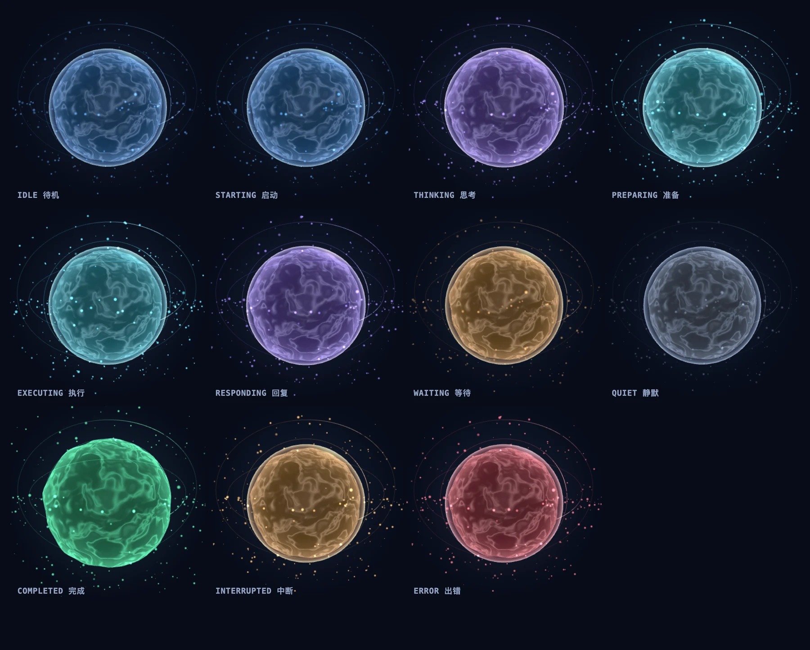
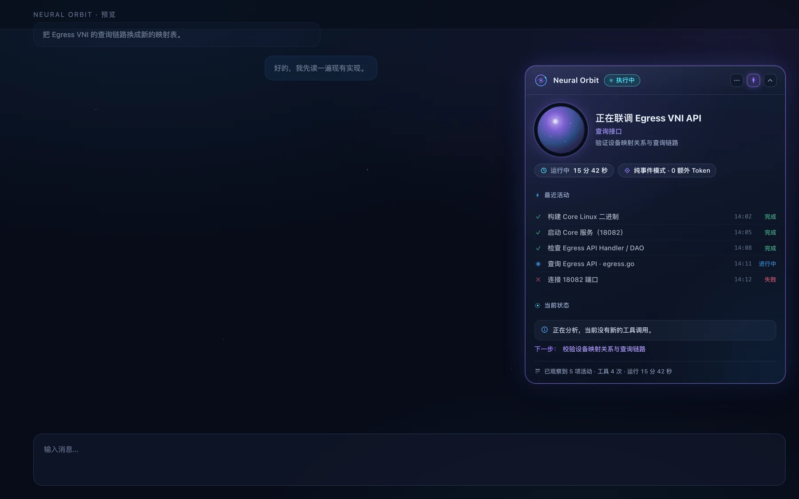
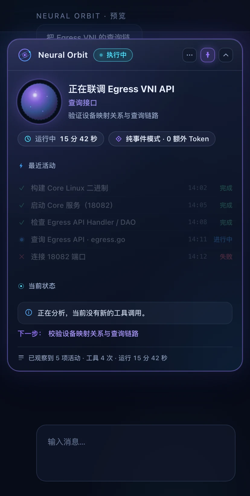
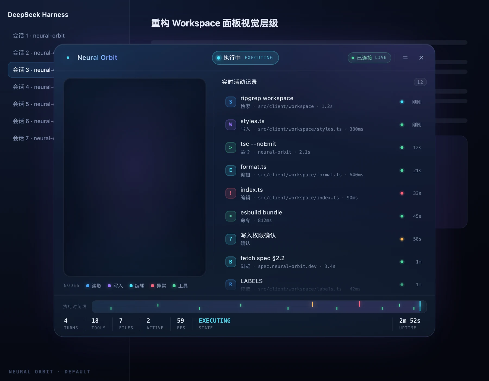
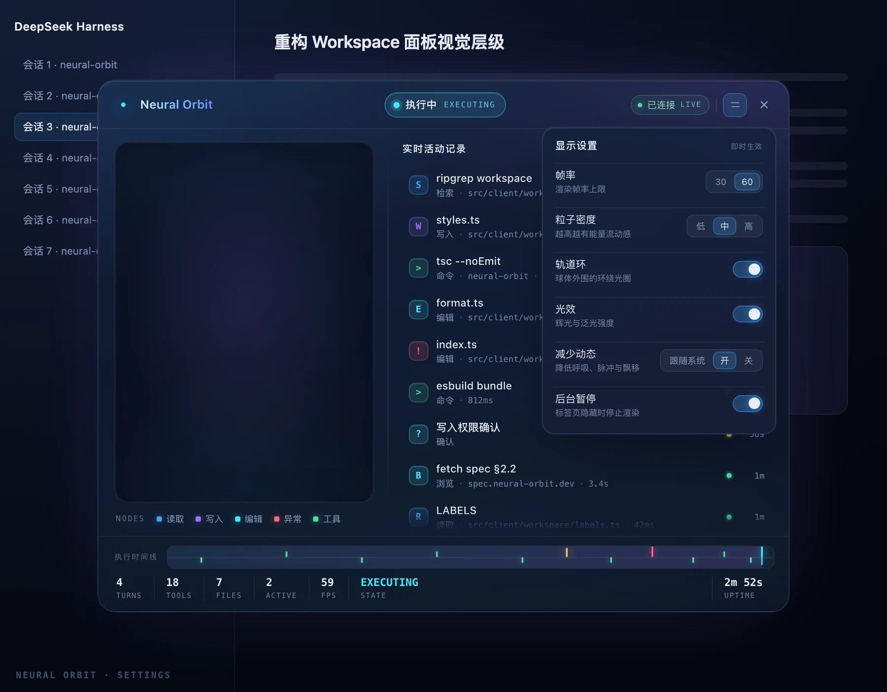

# Caelum Orbis

3D AI Agent 状态伴侣 + Always-on 工作进度 HUD（DeepSeek Harness Web 插件）。

**不用打开任何面板**：Agent 一开始工作，对话区右侧就浮出一块 470px 宽的玻璃面板，实时告诉你**当前任务是什么、进行到哪个阶段、最近完成了哪 5 件事、正在做什么、以及是不是已经安静了 45 秒**。想要细节时再点开：一颗活的 3D 能量球 + 一整块磨砂玻璃工作空间（能量球、活动记录、执行时间线、统计）。

- 所有状态来自 **DSH 真实事件**，不调用 LLM，不消耗 Token，不读取模型推理内容。
- 只读、只观察：不执行工具、不写会话、不落库。
- 不修改 DSH 源码；Host 与 Client 各自可独立停用；总开关关闭后连渲染器一起释放。

## 预览

十一状态的 3D 能量球（headless Chrome + SwiftShader 真实 WebGL 渲染，非示意图）：



Always-on HUD（470px 玻璃面板：任务标题 / 阶段 / 运行时长 / 纯事件模式 / 最近 5 条活动 / 当前状态 / 下一步 / 真实计数）：



窄屏（414px）自动改为顶部浮动：



Workspace 面板与设置（v1 截图，v2 布局未变，仅新增 4 项设置与 11 状态文案）：





---

## 一、它能做什么

### Always-on HUD（v2 新增）

| 项 | 值 |
|---|---|
| 尺寸 | 宽 `min(470px, 92vw)`，高随内容自适应（最大 `calc(100vh - 180px)`，内部滚动） |
| 位置 | 对话区右侧，`top: 118px`，不遮挡底部输入区；≤1100px 收窄到 420px；≤720px 改为顶部浮动 |
| 标题栏 | Logo（内联 SVG 圆环）+ 名称 + 状态胶囊 + `···`（打开 Workspace）+ 📌（固定）+ 收起 |
| 任务主体 | 左侧 96px 能量球（同一个 WebGL renderer）+ 右侧**任务标题**（来自 `session/title`，没有就写「当前任务处理中」）+ **阶段** + 当前动作 |
| 运行信息 | 运行时长 + 「纯事件模式 · 0 额外 Token」 |
| 最近活动 | 最多 5 条：状态图标 + 描述 + 时间 + 状态词；成功绿 / 执行中蓝 / 模型处理紫 / 等待黄 / 失败红 |
| 当前状态 | 一句话。静默时给出真实秒数（「已连续 45 秒没有收到新的活动事件。」），**永远不会说「卡死」** |
| 下一步 | 仅当 Agent 自己写了 `todo/write` 计划才显示，否则整块不出现 |
| 底部 | 只打真实计数：已观察到 N 项活动 · 工具 M 次 · 运行 X 分 Y 秒 |
| 自动展开 | `auto` 模式下 Agent 活跃即展开，空闲收成紧凑胶囊；用户点过收起后**永不自动弹回** |
| 固定 | 📌 固定后空闲也不折叠（手动收起仍优先） |

### 悬浮能量球（Launcher）

| 项 | 值 |
|---|---|
| 默认位置 | 右下角，右 24px / 下 24px |
| 尺寸 | 76px |
| 交互 | 点击展开 Workspace；再次点击或 ESC 关闭；可拖动（位置存 localStorage）；悬停显示状态与在跑工具数；悬停左上角 × 隐藏，隐藏后原地留一颗小圆点可重新唤出 |

球体本身是真实 3D：内层自定义 GLSL 能量材质、外层玻璃壳、多层半透明轨道、外围粒子。状态切换是插值过渡，不是换图。

### Workspace 工作空间

780×600，最大 94vw×88vh，深色磨砂玻璃：

- 顶部：产品名、状态胶囊、SSE 连接状态、关闭按钮。
- 左侧：3D 能量球 + 节点图例。
- 右侧：实时活动记录（最多 40 条，最新在上）：工具/文件/审批/Agent 四类，带状态色、相对时间、耗时、截断后的目标文件名。
- 底部：执行时间线 + 统计（轮次 / 步数 / 工具 / 文件 / 在跑工具 / 实测帧率）。
- 设置：总开关、显示模式、常驻卡片开关、活动列表开关、帧率 30/60、粒子密度、轨道、光效、减少动态、后台暂停。

### 十一状态

| 状态 | 触发（全部为真实事件） | 视觉 |
|---|---|---|
| `idle` | 无在跑工作 | 蓝，缓慢呼吸 |
| `starting` | `turn/start` 后还没有 step | 蓝，略活跃 |
| `thinking` | `step/start`、`reasoning-delta`、attempt 开始 | 紫，能量脉冲 |
| `preparing` | `tool-call-delta`（工具参数正在生成） | 青紫之间，流体加快 |
| `executing` | 有未结算的 `tool/call` | 青蓝，粒子高速流动 |
| `responding` | 首个 `text-delta` | 紫，流体更快 |
| `waiting` | `approval/asked`（未决） | 琥珀，轨道减速 |
| `quiet` | 运行中且静默 ≥30s、无工具在跑 | 灰蓝，全场最静，只留一丝微光 |
| `completed` | `turn/end{completed\|max-tokens}`、`agent/turn-stopping` | 绿，能量聚合扩散 |
| `interrupted` | `turn/end{interrupted\|aborted}`、`assistant/message.interrupted` | 琥珀，短暂高频 |
| `error` | `agent/error`、`turn/end{error\|blocked}` | 红，短促警示 |

优先级：

```
waiting > error > interrupted > completed > executing
        > quiet > responding > preparing > thinking > starting > idle
```

三条关键规则：

1. **`agent/status: running` ≠ 在思考**。运行时会话循环只有 `idle/running/maintenance` 三态，唤醒也会先报 running，所以它最多把状态带到 `starting`；真正的"思考"要等 `step/start` 或 `reasoning-delta`。
2. **`executing` 不吃静默**。一个跑 3 分钟的命令仍是"执行中"，静默档位单独上报（`quietLevel` 0–3），不把"在干活"误判成"卡住"。
3. **`completed` / `interrupted` / `error` 是带寿命的保持态**（2500ms / 3000ms / 4000ms），到期自动回落。

静默四档：`0–30s` / `30–60s` / `60–180s` / `>180s`，用 `performance.now()` 单调时钟测量，系统时间跳变不会凭空制造静默。

> 第一档取 30s 而不是 10s 是有意的：`quiet` 是"连流式帧都停了"的信号，而一次普通的推理停顿、一次长命令的工具执行都能轻松超过 10s —— 10s 会让面板在完全正常的回合里反复闪进"安静"。真正要防的"卡住"在 30s 以上才有意义。

---

## 二、架构

```
DSH Host 进程                         浏览器（DSH Web GUI）
┌──────────────────────────────┐      ┌───────────────────────────────────┐
│ session/event（14 类会话事件）│      │ shell.overlay 入口（OrbitLayer）   │
│ agent/assistant-stream       │      │  ├ HUD 进度卡（纯 DOM，常驻）      │
│ agent/status / error         │      │  ├ Launcher（76px 3D 球）          │
│ agent/turn-stopping /disposed│      │  ├ Workspace（玻璃面板 / 3D 大球） │
│ approval/request（瀑布）      │      │  ├ transport（SSE + 轮询兜底）     │
│        ↓                     │      │  └ store（zustand + localStorage） │
│ normalize（白名单化）         │      │                ↑                  │
│ classifier（13 族分类）       │      │                │                  │
│ correlation（callId 关联）    │ SSE  │                │                  │
│ stream（瞬时帧→相位）         │─────▶│  GET /api/orbis/events            │
│ quiet（单调时钟静默）         │ JSON │  GET /api/orbis/state             │
│ 11 状态机 + 40 条环形缓冲     │      │                                   │
│ OrbitSnapshot                │      │                                   │
└──────────────────────────────┘      └───────────────────────────────────┘
```

源码目录：

| 路径 | 职责 |
|---|---|
| `src/shared/protocol.ts` | 唯一共享契约：`OrbitSnapshot` / `OrbitActivity` / 常量 |
| `src/host/index.ts` | 插件入口：挂 8 个监听、起 ticker、注册路由、卸载清理 |
| `src/host/hub.ts` | 每会话状态 fold、双时钟、40 条环形缓冲、会话 LRU、通知节流 |
| `src/host/state-machine.ts` | 十一状态机（纯函数，可测） |
| `src/host/correlation.ts` | callId 关联：乱序 / 重复 / 结果先到 / 超时 |
| `src/host/stream.ts` | 瞬时帧折叠（只读类型标签） |
| `src/host/context/silence-detector.ts` | 单调时钟与静默四档 |
| `src/host/context/phase-inference.ts` | 由流式帧推断「准备 / 思考 / 回复」 |
| `src/host/context/task-context-engine.ts` | 任务上下文：标题、计划、活动聚合 |
| `src/host/context/activity-aggregator.ts` | 活动行 → 计数与最近完成项 |
| `src/host/activity/classifier.ts` | 工具分类注册表（13 族）+ `unknown` 兜底 |
| `src/host/activity/normalizer.ts` | 工具调用 → Activity DTO |
| `src/host/activity/redactor.ts` | 隐私白名单：浏览器能看到的字段全由这里产出 |
| `src/host/routes.ts` | `/state` 与 `/events`（SSE）只读路由 + 收容检查 |
| `src/client/index.tsx` | 浏览器入口：注册 `shell.overlay` + 词典 |
| `src/client/layer.tsx` | 覆盖层编排：总开关、生命周期、HUD 挂载、双渲染器 |
| `src/client/hud/` | Always-on 进度卡（纯函数规则 + 卡片组件） |
| `src/client/launcher.tsx` | 悬浮球（拖动 / 隐藏 / 提示） |
| `src/client/workspace/` | 玻璃工作空间面板 |
| `src/client/orb/` | three.js 能量球渲染器 |
| `src/client/store.ts` | zustand store + localStorage 持久化 + v1 迁移 |
| `src/client/transport.ts` | SSE 客户端 + 自动重连 + 轮询兜底 |
| `src/client/visual.ts` | 快照 → 渲染输入（强度/质量档位/跟随会话） |

### 事件 → 活动行的映射

| DSH 事件 | 用途 |
|---|---|
| `turn/start` | `starting`、轮次计数 |
| `step/start` / `step/end` | `thinking`、步数计数 |
| `tool/call` | 建活动行（running），按 13 族分类，按 `callId` 记账 |
| `tool/result` | 结行（success/error/cancelled）+ 耗时（取 `message.toolCallId`） |
| `approval/asked` / `approval/decided` | 审批行 + `waiting`，四种 outcome 各自落账 |
| `assistant/message`（`interrupted: true`） | `interrupted` |
| `llm/retry` | 重试计数（failure 正文不转发） |
| `turn/end` | 按 7 种 `reason.kind` 收束，清算所有在跑工具 |
| `agent/assistant-stream` | 实时相位：`reasoning-delta`→思考、`text-delta`→回复、`tool-call-delta`→准备 |
| `agent/status` / `turn-stopping` / `error` / `disposed` | 弱信号 / 完成动画 / 错误态 / 会话清理 |
| `approval/request`（瀑布） | 立刻点亮等待态；必定 `next()`，不改变审批结果 |

---

## 三、安全与隐私

- **白名单**：浏览器只能看到工具家族、工具名、截断后的 **basename**、状态、时间、耗时、白名单错误码。
- **DTO 里没有的字段**（有单测逐条断言）：`rawArguments`、`rawCommand`、`fileContent`、`reasoningText`、`userMessage`、`rawToolResult`。
- **流式帧只读类型标签**：`chunk.type` 之外的内容（`text`、`argumentsDelta`）从不读取、不存储、不传输。
- 路径只取最后一段（`/Users/alice/secret/plan.md` → `plan.md`），并截断到 40 字符。
- 前端全部 React 文本渲染，无 `innerHTML`。
- 只读 API：没有任何写操作、执行操作或远程命令入口。
- 路由随插件卸载注销；SSE 连接在卸载与客户端断开时关闭。
- 不新增遥测、不访问第三方域名、不产生额外 LLM 调用。

---

## 四、性能

- 默认 30 FPS，可选 60；渲染器内部按累计时间节流，不会超帧。
- `devicePixelRatio` 上限 1.5；粒子数 low≈120 / medium≈260 / high≈480（均 < 500）。
- HUD 是纯 DOM，无 WebGL，只有一个 1 秒定时器（把「已静默 N 秒」重新算一遍，避免秒数停住）；快照不变时不重渲染。
- 瞬时流式帧最多几十帧/秒，但 Host 对订阅者按 120ms 窗口节流推送，SSE 不会被刷爆。
- 标签页隐藏、窗口失焦、Workspace 关闭时暂停对应渲染循环；悬浮球在 Workspace 打开时也暂停（省一个 GPU 上下文）。
- 渲染器随 canvas 创建一次，状态更新只调用 `setState`，**不会重建场景**。
- 关闭 Workspace 即 `dispose()`：释放 geometry / material / texture / renderer。
- **总开关关闭**：不建 EventSource、不建渲染器、不装定时器、清空快照，只留一个「启用」按钮。
- Host 侧每会话 40 条活动、最多 8 个会话 LRU，ticker 250ms 且无待处理状态时立即返回；孤儿工具调用 10 分钟自动结算，不会把状态钉在 `executing`。
- 减少动态效果（跟随系统）时自动降为低粒子、关光效、停呼吸动画。

---

## 五、开发

```bash
git clone https://github.com/mycherish/dsh-orbis.git
cd dsh-orbis
pnpm install        # three / zustand / esbuild / typescript / vitest / prettier
pnpm build          # 产出 index.js（Host ESM）与 client.js（ModuleLoader 格式）
pnpm typecheck      # tsc --noEmit（整仓）
pnpm test           # vitest
pnpm format         # prettier --write（改动前跑一次，CI 会检查）
pnpm verify         # build + typecheck + test + format:check
```

- **构建**：`scripts/build.mjs` 用 esbuild 直接产出两个产物；`client.js` 由打包后的 CJS 体包进 `window.__ModuleLoader__.load({ id, factory(require) })` 信封，`react` 保持 external（由页面模块表提供），`three` 与 `zustand` 打进包内（离线可用，不依赖 CDN）。
- 未使用 Vite：本插件只需要两个入口的单文件产物，esbuild 直接完成即可，少一层配置。
- **格式**：Prettier（`printWidth: 110`、单引号、尾逗号 all），CI 有独立的 `format:check` 作业。格式化历史提交记在 `.git-blame-ignore-revs` 里，`git config blame.ignoreRevsFile .git-blame-ignore-revs` 之后 `git blame` 不会把它算到每一行头上。
- **没有 ESLint**：`typescript-eslint` 8.72.2 在 TypeScript 7.0.2 下**拒绝加载**（`does not support TS 7.0`，上游 issue #10940）。加一个跑不起来的 lint 步骤比没有更糟；`tsc --noEmit`（`strict` + `noUncheckedIndexedAccess`）本就是这里的承重检查。等上游支持 TS ≥ 7.1 再补一个 CI 步骤即可。

### 环境要求

| 项 | 要求 | 原因 |
|---|---|---|
| DSH | **0.2.2-rc.1 及以上**（`<0.3.0`） | 插件的两条路由注册成 `{ resource }`，由 carrier 的 `WebServer.serveResource` 分发（它负责造 `Request`、取 `Response`、并在 socket 断开时 abort 请求信号）。这个分支 0.2.2-rc.1 才有；`0.2.1-rc.x` 只认 `handler(req, res)`，装上去路由一个都答不上来。该下限写在 `package.json -> engines.dsh`，由 `tests/release-contract.test.ts` 守住 |

**只读路由的暴露面（只许本机）**：`/api/orbis/state` 与 `/api/orbis/events` 不带鉴权（宿主只在 `serveResource` 里做 GET/HEAD 过滤），所以它们自己做了一层收容检查，规则从 2.1.7 起收紧为：

| 请求 | 结果 |
|---|---|
| `Host` 是 `127.x.x.x` / `localhost` / `[::1]`，浏览器同源访问 | ✅ 200 |
| `Host` 是本机地址，但 `Origin` 指向别的域 | ❌ 403 |
| `Host` 非 loopback（哪怕页面自称同源） | ❌ 403 |
| `Origin: null`（沙箱 iframe、`file://` 页面） | ❌ 403 |
| `Sec-Fetch-Site` 是 `cross-site` / `same-site` | ❌ 403 |

也就是说：**把 DSH 监听到局域网后，别的设备（手机、另一台电脑）看不到这个面板** —— 宁可不可用，也不要一个"看起来能用、实际不设防"的入口。这一条是有意的取舍。

**它不是鉴权，这点必须说清楚。** 载体的 `serveResource` 只把请求头交给插件、不传 peer 地址（这一点是从 `app.asar` 里的实现读出来的），所以插件无法区分"本机进程"和"局域网里伪造了 `Host: 127.0.0.1` 的进程"。上述检查能挡住浏览器发起的读取（包括 DNS rebinding 那种形状），挡不住一个会自己编请求头的局域网进程。**如果你确实要把 DSH 暴露到局域网，请在前面挂一个有认证的反向代理**，不要依赖这层检查。

### 安装 / 卸载

#### 四条通道，任选其一

四条通道最终都写同一份 `~/.dsh/profiles/<profile>/package.json` 并跑一次 pnpm，所以插件本身不区分来源。

| 通道 | 命令 / 操作 | 适合 |
|---|---|---|
| **Web GUI** | 设置 → 插件 → 添加插件 → 安装第三方插件 → 填 spec | 桌面日常，最省事 |
| **plugin_manager 工具** | `install_bundle` 传 `target=<spec>` | 让 Agent 代装（本文档多数步骤用它） |
| **DSH CLI** | `dsh plugin --profile <profile> add <spec>` | 脚本化 / 远程终端；后面的参数原样透传给 pnpm，`--registry=` 之类也在这里给 |
| **手改清单** | `package.json` 里加依赖 + `pnpm install` | CI、离线镜像、需要精确锁版本 |

#### spec 语法

`plugin_manager` 与 CLI 共用同一个解析器（`dsh-plugin-manager` 的 `parseInstallSpec`），四类写法：

| 形式 | 写法示例 | 说明 |
|---|---|---|
| registry | `dsh-orbis`、`dsh-orbis@2.1.4`、`dsh-orbis@^2` | npm 包名，可带版本范围。默认就是这一类 |
| 本地目录 | `link:/绝对路径/dsh-orbis`、`file:/绝对路径/dsh-orbis`、`/绝对路径/dsh-orbis` | **相对路径会被直接拒绝**，必须写绝对路径。`link:` 不复制文件，改代码即时生效 |
| tarball | `/绝对路径/dsh-orbis-2.1.4.tgz`、`https://…/dsh-orbis-2.1.4.tgz` | 离线 / 内网分发。`npm pack` 产出的就是这个 |
| git | `github:mycherish/dsh-orbis#v2.1.4`、`git+https://github.com/mycherish/dsh-orbis.git`、`git@github.com:mycherish/dsh-orbis.git` | 跟主干或某个 tag。也认 gitlab / bitbucket / gist 简写 |

> ⚠️ **用 npm spec 重装会覆盖现有的 `link:` 安装。** 本地改了源码、却用 `dsh plugin --profile desktop add dsh-orbis` 重装一次，profile 里那条 `link:` 就会被替换成 npm 上的版本 —— 于是你的改动"不见了"，而代码其实还在磁盘上。改代码时请始终用 `link:` 那条路径。

#### 国内网络

pnpm 的镜像参数在 CLI 通道直接透传：

```bash
dsh plugin --profile desktop add dsh-orbis --registry=https://registry.npmmirror.com
```

npmmirror 对新版本有分钟级同步延迟；刚发布的版本如果 404，等一会儿或临时加 `--registry=https://registry.npmjs.org`。本插件没有 `postinstall`、没有原生模块、不联网下载任何运行时资源，所以镜像只影响下载本身。

#### 装完自检

1. **刷新一次 Harness 页面**（浏览器半每个页面代次只加载一次，不刷新看不到新插件）。
2. 右下角应出现进度卡或能量球；关掉「常驻进度卡」时是悬浮球。
3. 路由自检（端口换成你 GUI 地址里的那个）：

   ```bash
   curl -s -o /dev/null -w '%{http_code}\n' http://127.0.0.1:<port>/api/orbis/state
   ```

   | 返回 | 含义 |
   |---|---|
   | `200` | 正常，Host 半在跑且路由已注册 |
   | `403` | 被收容层拒了 —— 用了非 loopback 的地址（如局域网 IP）、跨站 Origin、`Origin: null`，或 `Sec-Fetch-Site` 声明是跨站（见上一节） |
   | `404` | 路由没注册：DSH 版本低于 `0.2.2-rc.1`，或插件没启用 |
   | 连接被拒 | 端口不对 / DSH 没监听 |

#### 卸载

三种都干净，挑一个：

```text
plugin_manager remove_bundle   target=dsh-orbis          # Agent / GUI 通道
dsh plugin --profile desktop remove dsh-orbis            # CLI
# 或手改 package.json 去掉依赖后 pnpm install
```

插件没有后台服务、没有跨会话落盘数据；卸载后浏览器侧残留的只有 localStorage 里的 `orbis.*` 偏好键（面板位置、HUD 折叠状态等），手动清掉即可。

---

## 六、验证状态

在本机（`dsh` 0.2.2-rc.1 / desktop profile）实测：

| 项 | 命令 / 方式 | 结果 |
|---|---|---|
| 类型检查（`strict` + `noUncheckedIndexedAccess`） | `tsc --noEmit -p tsconfig.json` | ✅ 0 错误 |
| 格式 | `prettier --check` | ✅ 全部文件符合（CI 独立作业守着） |
| 文字对比度 | `vitest run tests/contrast.test.ts` | ✅ 四份样式表全部文本 ≥ WCAG AA（4.5:1；图标 ≥3:1），由脚本按真实色值算 |
| 单元 / 集成测试 | `vitest run` | ✅ **385 项 / 25 文件**全过（含发布契约：产物 banner 必须与 `package.json` 同版本） |
| 构建 | `node scripts/build.mjs` | ✅ `index.js` 71.4 kB、`client.js` 682.4 kB（41 模块），两次构建 sha256 一致 |
| 发布体积 | `npm pack` | ✅ 19 个文件、828.5 kB（截图已转 WebP，8.7 MB → 613 kB） |
| 运行时数据通路 | `curl /api/orbis/state` | ✅ 返回 v2 快照：`task.taskTitle` / `task.phase` / `task.silence.label` / 活动行 / 计数 全部在线生成 |
| 静默与执行态共存 | 同上（工具执行中连续采样） | ✅ `silenceMs` 44→2112→4158 递增，状态保持 `executing` |
| Host 行激活 | `plugin_manager list_plugins` / `set_plugin` | ✅ 重载 `applied`，无 warning |
| 十一状态渲染 | headless Chrome + SwiftShader | ✅ `docs/orb-states-v2.webp` |

测试覆盖要点：十一状态机的全部迁移与优先级、静默分档、`executing` 不吃静默；callId 乱序 / 重复 / 结果先到 / 超时 / drain；瞬时帧只暴露类型标签；审批双通道合并与四种 outcome；**路径与参数脱敏**；SSE 首帧 / 变更推送 / 版本单调 / 卸载关流；总开关关闭后的设置迁移与零副作用路径；HUD 文案与展开策略；11 状态动效签名两两互异；**单一 canvas 在 Workspace / HUD / 悬浮球之间迁移后仍存活**（关掉 Workspace 球体变黑的那次回归）；ESC 只吃本面板的按键、关闭后焦点不落到 `<body>`、非模态面板不谎报 `aria-modal`。

未覆盖（需在真实页面人工确认）：

- HUD 与能量球、输入框在真实页面里的合成效果（截图是样式复刻，不是活页面）。
- 总开关关闭后「无 SSE 连接 / 无 rAF / WebGL 上下文已释放」的 devtools 实测。
- 长时间内存曲线（30 分钟）、真实 GPU 下的 60 FPS 稳定性、Safari 的 `backdrop-filter` / `color-mix`。

### 与需求文档的实现差异（有意为之）

1. **构建用 esbuild 而非 Vite/tsdown**：两个单文件产物，esbuild 直接产出即可。
2. **SSE 为主 + 轮询兜底**：若某个中间层缓冲了流，客户端 2.5s 内收不到首帧就改为轮询 `/state`（900ms），SSE 恢复即停。
3. **HUD 里的 `0 额外 Token` 只指插件自身**：不表示 DSH 主任务不消耗 Token。
4. **活动行一条对应一次工具调用**：文件类工具那一条同时是"工具节点"和"文件节点"（带 `fileKind` + 脱敏 `safeTarget`），不重复两行。
5. **`quiet` 只覆盖"没有工具在跑"的静默**：跑长命令时的静默由 `quietLevel` 单独上报，状态保持 `executing`，避免把"在干活"说成"卡住"。
6. **协议版本升到 3，并且写进了快照**：DTO 字段更名（`name→label`、`timestamp→startedAt`、`target→safeTarget`）。快照现在带 `protocol` 字段，客户端比对不上就丢掉整份数据、只显示一句「版本不匹配，请刷新页面」——不是抛异常，也不是拿旧字段硬渲染。真实会撞上的场景只有一个：页面代次活着、Host 进程换了新版本。
7. **快照有单调守卫**：同 Session 下，版本更旧且 `updatedAt` 不更新的快照会被丢弃。SSE 与轮询兜底可能短暂并存，一条早发出的轮询响应不应盖掉后到的新帧；而 Host 重启后 `version` 从 1 重来、`updatedAt` 更新，所以新进程仍能接管。
8. **二级文字的透明度有下限**：`labelDim` 本身是 6.6:1，但样式里再叠一层 `color-mix(… 62%, transparent)` 就掉到 1.90:1。现在所有小字号文字走同一个 `quiet()` 下限（85%，约 5.2:1），只保留 85 / 92 / 96 三档层次。`tests/contrast.test.ts` 从样式表本身算，不靠人眼看。

### 上手

1. 刷新一次 Harness 页面（浏览器半每个页面代次只加载一次）。
2. 让 Agent 干点活：右下角出现进度卡（默认 30 FPS，纯 DOM，不吃 GPU）。
3. 点卡片上的「展开 Workspace」看细节；点卡片右上 × 收起后，它不会再自己弹出来。
4. 设置里可以：关掉常驻卡片、切成"仅球体"、或一键关掉整个 Caelum Orbis（连渲染器一起释放）。
