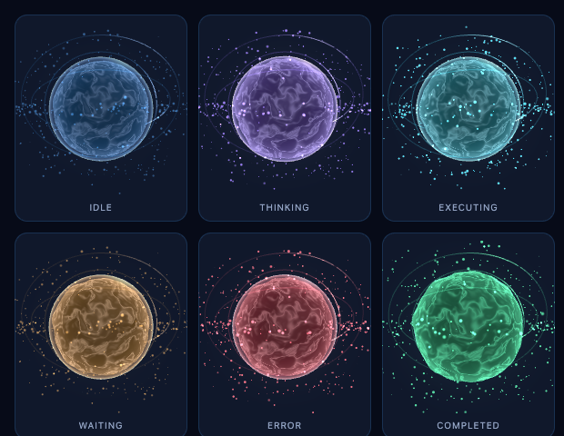
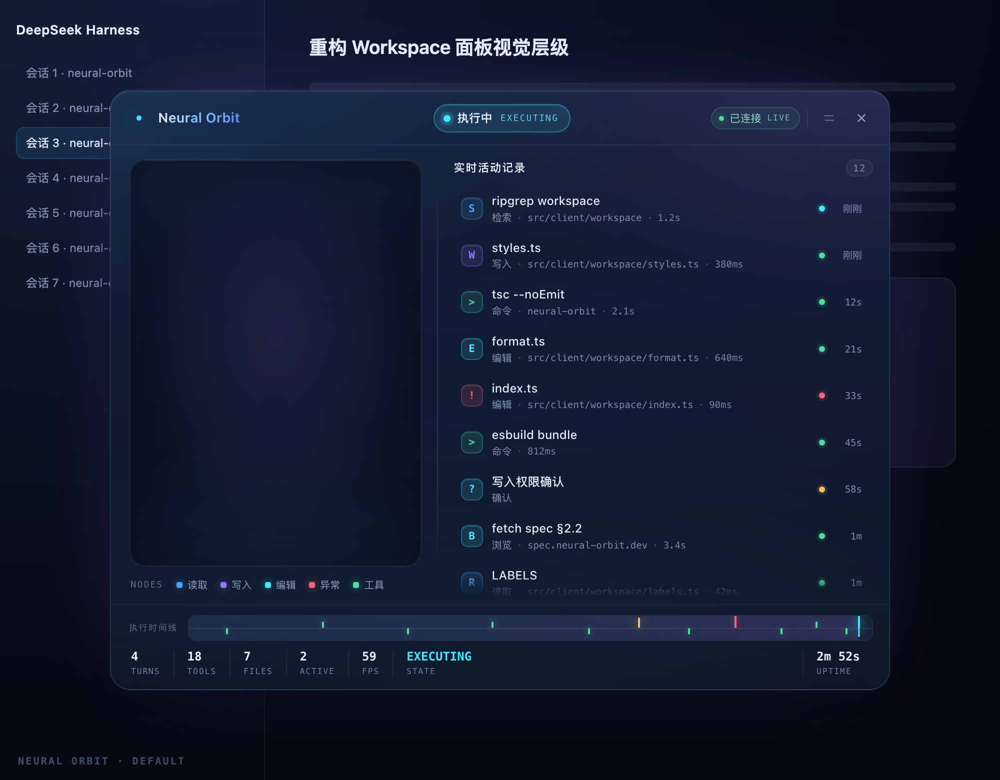
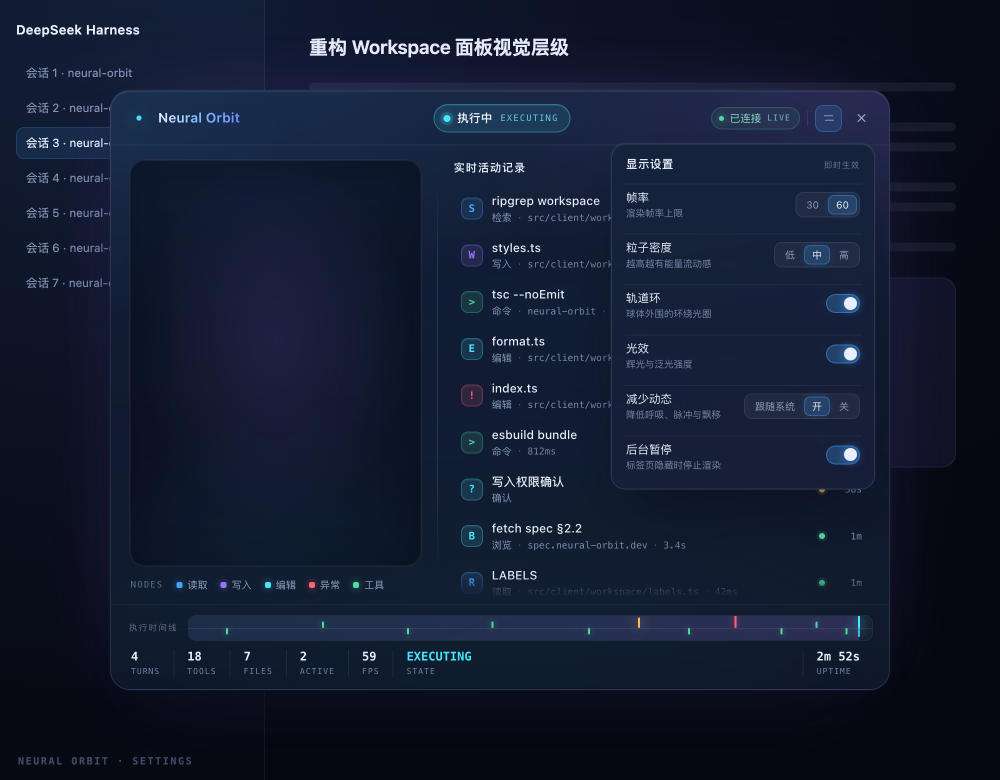

# Neural Orbit

3D AI Agent 状态伴侣与执行过程可视化（DeepSeek Harness Web 插件）。

右下角一颗悬浮的 3D 能量球，实时反映 Agent 正在做什么：思考、执行工具、等你确认、出错、完成。点开是一整块磨砂玻璃工作空间：左边是活的能量球与空间节点，右边是实时活动记录，底部是执行时间线与统计。

- 所有状态来自 **DSH 真实事件**，不调用 LLM，不读取模型推理内容。
- 只读、只观察：不执行工具、不写会话、不落库。
- 不修改 DSH 源码；Host 与 Client 各自可独立停用。

## 预览

六状态的 3D 能量球（无头 Chrome + SwiftShader 真实渲染，非示意图）：



Workspace 面板（静态渲染：左侧 canvas 区在真实运行时会填入上面那颗球）：



设置面板：



---

## 一、它能做什么

### 悬浮能量球（Launcher）

| 项 | 值 |
|---|---|
| 默认位置 | 右下角，右 24px / 下 24px |
| 尺寸 | 76px |
| 交互 | 点击展开 Workspace；再次点击或 ESC 关闭；可拖动（位置存 localStorage）；悬停显示状态与在跑工具数；悬停左上角 × 隐藏，隐藏后原地留一颗小圆点可重新唤出 |

球体本身是真实 3D：内层自定义 GLSL 能量材质、外层玻璃壳、多层半透明轨道、外围粒子。状态切换是插值过渡，不是换图。

### Workspace 工作空间

780×600，最大 94vw×88vh，深色磨砂玻璃：

- 顶部：产品名、六状态胶囊、SSE 连接状态、关闭按钮。
- 左侧：3D 能量球 + 节点图例。
- 右侧：实时活动记录（最多 40 条，最新在上）：工具/文件/审批/Agent 四类，带状态色、相对时间、耗时、截断后的目标文件名。
- 底部：执行时间线 + 统计（轮次 / 工具 / 文件 / 在跑工具 / 实测帧率）。
- 设置：帧率 30/60、粒子 low/medium/high、轨道开关、光效开关、减少动态效果、隐藏时暂停。

### 六状态

| 状态 | 触发 | 视觉 |
|---|---|---|
| idle | `agent/status: idle` | 蓝，缓慢呼吸 |
| thinking | `agent/status: running` | 紫，能量脉冲 |
| executing | 有未完成的 `tool/call` | 青蓝，粒子流动 |
| waiting | `approval/request` | 琥珀，轨道减速 |
| error | `agent/error` 或 `turn/end` 且 reason=error | 红，短促警示 |
| completed | `agent/turn-stopping` / `turn/end` | 绿，能量聚合扩散 |

优先级 `waiting > error > completed > executing > thinking > idle`，其中 `executing` 由**在跑工具计数**驱动（并行工具不会互相覆盖），`completed` / `error` 是**带寿命的保持态**（默认 2500ms / 4000ms），到期自动回落 `idle`。

---

## 二、架构

```
DSH Host 进程                         浏览器（DSH Web GUI）
┌───────────────────────────┐         ┌──────────────────────────────────┐
│ session/event             │         │ shell.overlay 入口（OrbitLayer）  │
│ agent/status              │         │  ├ Launcher（76px 3D 球）         │
│ agent/turn-stopping       │         │  ├ Workspace（玻璃面板 / 3D 大球）│
│ agent/error               │         │  ├ transport（SSE + 轮询兜底）    │
│ approval/request          │         │  └ store（zustand + localStorage）│
│        ↓                  │         │                ↑                 │
│ normalize（白名单化）      │         │                │                 │
│        ↓                  │  SSE    │                │                 │
│ 状态机 + 40 条活动环形缓冲  │ ──────▶ │  GET /api/neural-orbit/events    │
│        ↓                  │  JSON   │  GET /api/neural-orbit/state     │
│ OrbitSnapshot             │         │                                  │
└───────────────────────────┘         └──────────────────────────────────┘
```

源码目录：

| 路径 | 职责 |
|---|---|
| `src/shared/protocol.ts` | 唯一共享契约：`OrbitSnapshot` / `OrbitActivity` / 常量 |
| `src/host/index.ts` | 插件入口：挂事件、起 ticker、注册路由、卸载清理 |
| `src/host/hub.ts` | 每会话状态fold、40 条环形缓冲、会话 LRU、订阅广播 |
| `src/host/state-machine.ts` | 六状态机（纯函数，可测） |
| `src/host/normalize.ts` | DSH 事件 → 活动行（安全边界，纯函数） |
| `src/host/routes.ts` | `/state` 与 `/events`（SSE）只读路由 |
| `src/client/index.tsx` | 浏览器入口：注册 `shell.overlay` + 词典 |
| `src/client/layer.tsx` | 覆盖层编排：生命周期、暂停规则、双渲染器 |
| `src/client/launcher.tsx` | 悬浮球（拖动 / 隐藏 / 提示） |
| `src/client/working` → `src/client/workspace/` | 玻璃工作空间面板（独立模块） |
| `src/client/orb/` | three.js 能量球渲染器（独立模块） |
| `src/client/store.ts` | zustand store + localStorage 持久化 |
| `src/client/transport.ts` | SSE 客户端 + 自动重连 + 轮询兜底 |
| `src/client/visual.ts` | 快照 → 渲染输入（强度/质量档位/跟随会话） |

### 事件 → 活动行的映射

| DSH 事件 | 用途 |
|---|---|
| `session/event` `tool/call` | 建活动节点（running），按工具家族分类 |
| `session/event` `tool/result` | 结节点（success/error）+ 耗时（取 `message.toolCallId`） |
| `session/event` `turn/start` `turn/end` | 轮次计数、状态转移、清空在跑工具 |
| `agent/status` | running/idle |
| `agent/turn-stopping` | 完成动画起点 |
| `agent/error` | 错误态（只取白名单错误码） |
| `approval/request` | 等待确认态（waterfall 监听后必定 `next()`，不改变审批结果） |

---

## 三、安全与隐私

- **白名单**：浏览器只能看到工具家族、工具名、截断后的 **basename**、状态、时间、耗时、白名单错误码。
- **绝不外发**：工具参数原文、命令内容、文件内容、提示词、模型推理、完整对话、绝对路径、家目录、用户名。
- 路径只取最后一段（`/Users/alice/secret/plan.md` → `plan.md`），并截断到 40 字符。
- 前端全部 React 文本渲染，无 `innerHTML`。
- 只读 API：没有任何写操作、执行操作或远程命令入口。
- 路由随插件卸载注销；SSE 连接在卸载与客户端断开时关闭。
- 不新增遥测、不访问第三方域名。

---

## 四、性能

- 默认 30 FPS，可选 60；渲染器内部按累计时间节流，不会超帧。
- `devicePixelRatio` 上限 1.5；粒子数 low≈120 / medium≈260 / high≈480（均 < 500）。
- 标签页隐藏、窗口失焦、Workspace 关闭时暂停对应渲染循环；悬浮球在 Workspace 打开时也暂停（省一个 GPU 上下文）。
- 渲染器随 canvas 创建一次，状态更新只调用 `setState`，**不会重建场景**。
- 关闭 Workspace 即 `dispose()`：释放 geometry / material / texture / renderer。
- Host 侧每会话 40 条活动、最多 8 个会话 LRU，ticker 250ms 且无保持态时立即返回。
- 减少动态效果（跟随系统）时自动降为低粒子、关光效。

---

## 五、开发

```bash
cd neural-orbit
pnpm install        # 已装好：three / zustand / esbuild / typescript / vitest
pnpm build          # 产出 index.js（Host ESM）与 client.js（ModuleLoader 格式）
pnpm typecheck      # tsc --noEmit（整仓）
pnpm test           # vitest
pnpm verify         # build + typecheck + test
```

- **构建**：`scripts/build.mjs` 用 esbuild 直接产出两个产物；`client.js` 由打包后的 CJS 体包进 `window.__ModuleLoader__.load({ id, factory(require) })` 信封，`react` 保持 external（由页面模块表提供），`three` 与 `zustand` 打进包内（离线可用，不依赖 CDN）。
- 未使用 Vite：本插件只需要两个入口的单文件产物，esbuild 直接完成即可，少一层配置；这是与需求文档 §4 的唯一构建差异。
- 若日后换回 Vite/tsdown，只需保持 `index.js`（ESM，默认导出 `apply`）与 `client.js`（ModuleLoader 信封）两个产物形态不变。

### 安装 / 卸载

```text
plugin_manager install_bundle  target=/Users/xuweidong/Desktop/Wayne/neural-orbit
plugin_manager remove_bundle   target=dsh-neural-orbit
```

安装后刷新一次 Harness 页面（浏览器半每个页面代次只加载一次），右下角出现能量球。

---

## 六、验证状态

在本机（`dsh` 0.2.2-rc.1 / desktop profile）实测：

| 项 | 命令 / 方式 | 结果 |
|---|---|---|
| Host 类型检查（`strict` + `noUncheckedIndexedAccess`） | `tsc --noEmit -p tsconfig.json` | ✅ 0 错误 |
| 单元 / 集成测试 | `vitest run` | ✅ **48 项 / 6 文件**全过 |
| 构建 | `node scripts/build.mjs` | ✅ `index.js` 23.1 kB、`client.js` 639.4 kB（29 模块，three+zustand 已打入） |
| 产物形态（ModuleLoader 信封 / `apply` / `inject` / 槽位注册） | 9 项断言 | ✅ 全过 |
| 安全扫描（产物） | 无远程 URL、无 `eval`/`new Function`、无 `innerHTML`、`react` 保持 external、无子进程/文件写 | ✅ 全部为 0 |
| Host 行激活 | `plugin_manager list_plugins` | ✅ `include:neural-orbit` `fiberPhase: active` |
| 浏览器入口 | Client `Slots.listSubTree('shell.overlay')` | ✅ `neural-orbit` 占用，order 120，`active: true` |
| bundle 安装 | `plugin_manager install_bundle` | ✅ `application: applied`，无 warning |

测试覆盖：六状态机的全部文档化转移与优先级、并行工具、保持态过期；事件归一化与**路径/参数脱敏**（`/Users/alice/secret/plan.md` → `plan.md`，bash 命令不外发）；hub 的会话隔离、40 条上限、会话 LRU、版本自增；**SSE 路由**（首帧快照、变更推送、版本单调、卸载关流并注销路由）；Host 装配的端到端链路（事件进 → `/state` JSON 出、审批 waterfall 必须 `next()`）。

未覆盖（需人工在真实页面确认）：

- 视觉合成：3D 球 + 玻璃面板 + 真实宿主背景的观感（子模块各自用 headless Chrome 验过 GLSL 编译与静态布局，但不是合成效果）。
- 长时间内存曲线（30 分钟）、真实 GPU 下的 30/60 FPS 稳定性、Safari 的 `backdrop-filter`/`color-mix`。

### 与需求文档的实现差异（有意为之）

1. **构建用 esbuild 而非 Vite/tsdown**：本插件只需两个单文件产物，esbuild 直接产出即可，少一层配置。产物形态（ESM `index.js`、ModuleLoader 信封 `client.js`）与文档要求一致。
2. **SSE 为主 + 轮询兜底**：若某个中间层缓冲了流，客户端在 2.5s 内收不到首帧就改为轮询 `/state`（900ms），一旦 SSE 恢复即停止轮询。协议与路由未变，只是让"实时"在任何环境下都能看到。
3. **活动行一条对应一次工具调用**：文件类工具的那一条同时是"工具节点"和"文件节点"（带 `fileKind` + 脱敏 `target`），不重复两行。

### 上手

1. 刷新一次 Harness 页面（浏览器半每个页面代次只加载一次）。
2. 右下角出现 76px 能量球；点它展开 Workspace，`ESC` 或再点一次关闭。
3. 悬停能量球可看到状态与在跑工具数，左上角 × 隐藏，隐藏后原地留小圆点可唤回。
